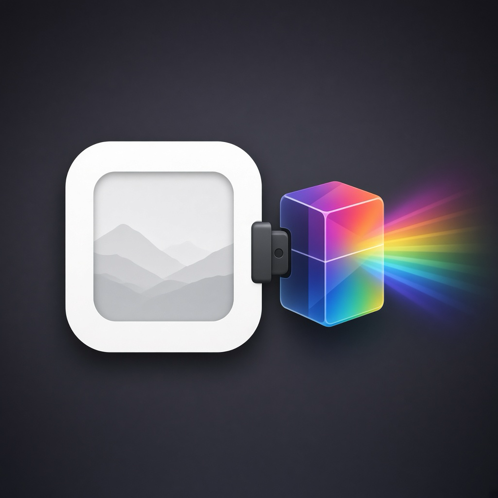
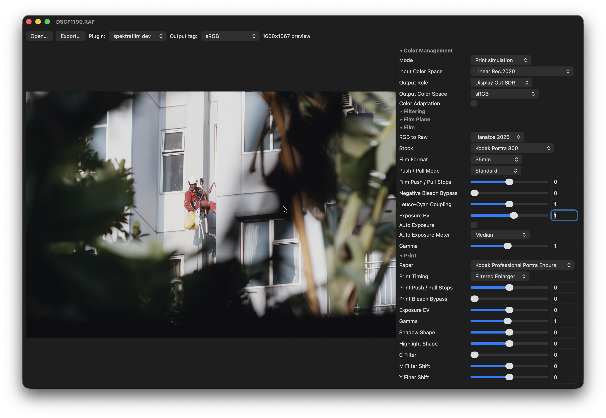

<p align="center">
  
</p>

# OFX Raw Host

[](https://github.com/aaronmurniadi/ofxrawhost/releases/latest)


[](https://discord.gg/B69ZgZRzk)

<a href="https://www.buymeacoffee.com/aaronmurniadi"></a>

A minimal still-image [OpenFX](https://github.com/AcademySoftwareFoundation/openfx) **plugin host**.
Open a RAW (or PNG/JPEG/TIFF/EXR) photo, run it through one or more OFX filter plugins, preview the result,
and export to PNG, JPEG, or 16-bit TIFF — no video NLE required.

Use it to try OFX effects that normally only run inside Resolve, Nuke, or similar hosts,
on still photos and a simple processing chain.



---

## Tested OFX plugins

| Plugin              | What it does                                                                                                                                                                                                    | Link                                                                                                                         |
| ------------------- | --------------------------------------------------------------------------------------------------------------------------------------------------------------------------------------------------------------- | ---------------------------------------------------------------------------------------------------------------------------- |
| **spektrafilm-ofx** | Film simulation (film, print, scan, grain, halation, diffusion)                                                                                                                                                 | [chaert-s/spektrafilm-ofx](https://github.com/chaert-s/spektrafilm-ofx) / [spektrafilm.114c.de](https://spektrafilm.114c.de) |
| **ntsc-rs**         | Analog video / VHS-style effects                                                                                                                                                                                | [valadaptive/ntsc-rs](https://github.com/valadaptive/ntsc-rs)                                                                |
| **purzOS**          | A collection of 64 native OpenFX video plugins for DaVinci Resolve, Natron, and any other OFX host — retro/analog looks, pixelart, glitch, datamosh, CRT/VHS signal artifacts, colour grades and optical warps. | [purzbeats/purzos-ofx](https://github.com/purzbeats/purzos-ofx)                                                              |

Other OFX filter plugins should work 🤞 If you confirm one, a PR to this table is welcome.

---

## Bundled plugins

### Transform

A bundled OFX plugin that zooms into an aspect-ratio region and rotates the image. It is compiled into the
Windows executable and shipped as an OFX bundle on macOS and Linux. Intended at the
**beginning of a plugin
chain** so downstream plugins process fewer pixels, it implements `getRegionOfDefinition` to report
the output dimensions directly to the host.

**Parameters:**

- **Aspect Ratio** — crop window aspect ratio. The list holds landscape ratios: _Original_ (source ratio), _1:1 (Square)_, _6:5 (Photo)_, _5:4 (Large Format)_, _4:3 (Classic TV)_, _1.37:1 (Academy)_, _7:5 (Photo)_, _1.43:1 (IMAX)_, _3:2 (Film Landscape)_, _16:10 (Widescreen)_, _1.66:1 (Super 16)_, _5:3 (Wide)_, _7:4 (Wide)_, _16:9 (Widescreen)_, _1.85:1 (Cinema Flat)_, _2:1 (Univisium)_, _21:9 (Ultrawide)_, _2.39:1 (Anamorphic)_, _3:1 (Panorama)_, and _4:1 (Extreme Wide)_. The default is _Original_.
- **Orientation** — _Landscape_ or _Portrait_, default _Landscape_. Portrait swaps the width and height of the chosen aspect ratio. _Original_ keeps the source shape and ignores this parameter.
- **Zoom** — zoom amount from 100 to 1000, default 100. At 100 the plugin outputs the full image (identity). Higher values crop to a centered region that matches the aspect ratio and sample it one to one. The output shrinks with the region, so downstream plugins process fewer pixels. At 1000 the region is 10% of the source in each dimension.
- **Rotate** — rotate the zoomed image about its center, in degrees, from -180 to 180, default 0. The crop window stays the output size; the image scales up as needed so the frame stays filled (straight edges, no black corner wedges).
- **Offset X / Offset Y** — pan the crop window from -100 to 100, default 0. At ±100 the window reaches the corresponding source edge. When the crop window fills the source in a dimension (e.g. a portrait aspect ratio on a wider source fills the height), the offset can slide the window **past** the source edge. The out-of-bounds area is filled with **black pixels**.

### Auto Exposure

A bundled OFX plugin that meters the frame brightness and applies one exposure
gain so the metered level lands on 18.4% gray. It is compiled into the Windows
executable and shipped in the same OFX bundle as Transform. The meter follows
the metering methods of the spektrafilm pipeline.

**Parameters:**

- **Metering**: _Average_, _Median_, _Center Weighted_ (default), _Partial_, _Matrix_, _Multi Zone_, or _Highlight Weighted_. Average and Median use the whole frame. Center Weighted, Partial, Matrix, and Multi Zone weight the center like a camera meter. Highlight Weighted favors the bright pixels.
- **Exposure Compensation**: bias added to the measured exposure, in EV, from -10 to 10, default 0. Negative values darken the image. Positive values brighten it.
- **Input Color Space**: color space of the source pixels, one of _sRGB_, _Display P3_, _Linear Rec.709_, or _Linear Rec.2020_. The host sets this from the opened image. The meter decodes the transfer curve and uses the matching luminance weights.

### Denoise (profiled)

A bundled OFX plugin that removes sensor noise using a model of the sensor
rather than a plain blur. It is a port of the wavelets mode of darktable's
_denoise (profiled)_ module, and it is compiled into the Windows executable and
shipped in the same OFX bundle as Transform and Auto Exposure.

Sensor noise is not the same everywhere in a frame. Photons arrive at random, so
the noise grows with the signal (shot noise), and the read-out adds a floor that
dominates the shadows. The plugin describes that with two numbers per frame:

```
V(X) = a * X + b
```

where `X` is the linear signal with 1.0 at the sensor white level. It then
applies the generalized Anscombe transform, which turns that signal-dependent
noise into noise of unit variance, and runs edge-aware a-trous wavelets on the
stabilized image. Each of the seven bands gets a BayesShrink threshold sized
from the noise the band would carry against the detail it does carry, so flat
areas are smoothed hard while edges and texture are left alone. The transform is
inverted at the end. Because the thresholds are computed on unit-variance data,
the same amount of smoothing happens in the shadows and in the highlights.

**Parameters:**

- **Noise Slope (a)**: Poisson part of the model, default `3.55e-05`, which is a typical full-frame value for ISO 1600. The host fills it in from the detected camera profile; the default is what stays on a file that carries no camera data. Raise it for a noisier frame, lower it for a cleaner one. It grows roughly in proportion to the ISO setting.
- **Noise Offset (b)**: Gaussian part of the model, the read noise that is there even with no light, default `1.07e-07`. It is what dominates the deep shadows. The host fills it in from the detected camera profile as well.
- **Strength**: how hard the wavelets shrink the detail, from 0.001 to 1000, default 1. _1_ removes the noise the model above describes; higher values remove more of it at the cost of fine texture.
- **Preserve Shadows**: finetune the denoising of the dark areas, from 0 to 1.8, default 1. Decrease it to denoise them more aggressively, increase it to leave more shadow detail at the cost of shadow noise. darktable picks this from the profile as `clamp(0.1 - 0.1 * ln(a), 0.7, 1.8)`, which is 1.12 for the default _a_ and is worth setting by hand when _a_ moves a long way from it.
- **Bias Correction**: corrects a color cast in the shadows that the inverse transform can leave behind, from -1000 to 100, default 0. Decrease it if the shadows are too purple, increase it if they are too green.
- **Color Mode**: _RGB_ keeps the channels apart; _Y0U0V0_ (default) sums them into a luma-like signal that it denoises on its own and denoises the color differences separately, which keeps chroma noise down without flattening the fine texture as much.
- **Input Color Space**: color space of the source pixels, one of _sRGB_, _Display P3_, _Linear Rec.709_, or _Linear Rec.2020_. The host sets this from the opened image. The transform needs linear light, so the transfer curve is removed on the way in and applied again on the way out.

**Automatic detection:** when the open frame came from a RAW file, the host reads
its camera make, camera model and ISO setting, looks them up in the bundled copy
of darktable's noise profile database, and fills _Noise Slope_ and _Noise Offset_
with the profile of that camera at that ISO before the plugin renders. An ISO the
database has no shot for is interpolated between the two neighbouring settings,
and one outside the camera's range clamps to the closest setting it has. The
plugin is seeded when it joins the chain, and again when the open image changes
while the chain stays in place; a project or a sidecar that already stores the two
values keeps them, so a saved chain reproduces exactly. A JPEG or a TIFF carries
no sensor data, and the database does not know every camera, so for those the two
values are set by hand.

**Where the values come from:** the noise profile database holds, for every
supported camera and ISO setting, the fit of a flat shot to `V(X) = a * X + b`.
It ships with the app as a copy of darktable's `data/noiseprofiles.json` (see
[License](#license) — that file stays under darktable's GPL-3.0). The table below
holds the median of the database per ISO, as a starting point for a file that
carries no camera data and as a sanity check on a profile the host picked.
Sensors differ by more than a factor of two around those medians, so a profile
for the actual camera is always better: a model that is too high smoothes detail
away, and one that is too low leaves noise behind.

| ISO    | a       | b       |
| ------ | ------- | ------- |
| 100    | 3.155e-06 | 2.800e-09 |
| 200    | 5.023e-06 | 6.100e-09 |
| 400    | 9.395e-06 | 1.550e-08 |
| 800    | 1.812e-05 | 3.900e-08 |
| 1600   | 3.550e-05 | 1.072e-07 |
| 3200   | 6.710e-05 | 2.696e-07 |
| 6400   | 1.245e-04 | 5.614e-07 |
| 12800  | 2.267e-04 | 1.313e-06 |
| 25600  | 3.367e-04 | 2.124e-06 |
| 51200  | 4.270e-04 | 1.426e-06 |
| 102400 | 7.396e-04 | 3.572e-06 |

**Notes:**

- The noise model describes pixels of the full-resolution frame. The host renders previews at a reduced resolution, so it tells the plugin the proxy scale of every pass and the plugin scales `a` and `b` with it. A preview therefore shows the smoothing the export will write.
- The model is read from the green channel of the profile, as darktable does, and the image is assumed to be white balanced already, which is what the host hands over.
- The per-band frequency curve of darktable's module, which scales how hard each wavelet band is shrunk, is fixed here at darktable's default force of 0.5, because the host has no curve widget. _Strength_ is the single control for how hard the denoiser bites.

---

## Install

Download the package for your system from [Releases](https://github.com/aaronmurniadi/ofxrawhost/releases/latest).

### macOS

- **Apple Silicon (M1 and later):** `OfxRawHost-macOS-arm64.dmg`
- **Intel:** `OfxRawHost-macOS-x86_64.dmg`

Open it and drag **OfxRawHost** onto **Applications**.
The app is ad-hoc signed, so on first launch right-click it and choose **Open**, or run:

```sh
xattr -dr com.apple.quarantine /Applications/OfxRawHost.app
```

### Windows

Download `OfxRawHost-Windows-x64.exe` and run it. It is one self-contained file: the
libraries, the icon font, and the bundled plugins are all inside it, so there is nothing
to unpack and nothing to install, and it opens no console window. Windows may warn about
an unknown publisher because the executable is not code-signed.

The host needs an OpenGL 3.3 driver. On a machine without one, such as a virtual machine
or a remote desktop session with the generic display driver, it falls back to legacy
OpenGL rendering so the window still opens. When the window cannot start at all, a message
box explains why.

Run `OfxRawHost-Windows-x64.exe --selftest` from a command prompt to check the installation,
or to see the plugin load warnings. The console output appears in the terminal that starts it.

### Linux

Download `OfxRawHost-Linux-x86_64.AppImage`, then make it executable and run it:

```sh
chmod +x OfxRawHost-Linux-x86_64.AppImage
./OfxRawHost-Linux-x86_64.AppImage
```

The AppImage carries the host, the bundled plugins, and the libraries it needs.
It prefers OpenGL 3.3 and falls back to legacy OpenGL rendering when the driver offers
neither. The file dialogs use `zenity` or `kdialog`, so install one of them if the Open and
Export dialogs do not appear:

```sh
sudo apt install zenity
```

The AppImage carries update information, so AppImageUpdate updates it in place. A stable
build follows the newest stable release. A build from a `release/vX.X.X` branch follows the
newest pre-release, which is what the in-app update check does for a development build.

The release publishes the `.zsync` file that the update tool reads. Get `appimageupdatetool`
from the AppImageUpdate releases, and pass `-O` so it replaces the file in place:

```sh
appimageupdatetool -O ./OfxRawHost-Linux-x86_64.AppImage
```

An AppImage released before v0.4.3 carries no update information, so download one v0.4.3 or
later build by hand once to start receiving in-place updates.

Nothing is signature-verified, so an in-place update trusts the GitHub release channel.

---

## Installing OFX plugins

OFX Raw Host loads plugins from the platform default OFX directory plus any paths in `OFX_PLUGIN_PATH`:

| Platform | Default path                                |
| -------- | ------------------------------------------- |
| macOS    | `/Library/OFX/Plugins`                      |
| Linux    | `/usr/OFX/Plugins`                          |
| Windows  | `C:\Program Files\Common Files\OFX\Plugins` |

Install plugins the way their authors recommend (installer, package, or copy `*.ofx.bundle`
into the directory above). For example on macOS:

```sh
sudo mkdir -p /Library/OFX/Plugins
sudo cp -R path/to/*.ofx.bundle /Library/OFX/Plugins/
```

Or point the host at a build directory without copying (apps launched from Finder
don't see shell variables, so start it from the terminal):

```sh
OFX_PLUGIN_PATH=/path/to/plugins /Applications/OfxRawHost.app/Contents/MacOS/OfxRawHost
```

Restart OFX Raw Host after installing plugins. If none are found, the status bar says so.

---

## Build

Requires CMake 3.16+, a C++17 compiler, [LibRaw](https://www.libraw.org/),
[libtiff](https://libtiff.gitlab.io/libtiff/), [Little CMS 2](https://www.littlecms.com/),
[libwebp](https://developers.google.com/speed/webp), and [JPEG XL](https://libjxl.readthedocs.io/).
GLFW and Dear ImGui are fetched automatically by CMake.

```sh
# macOS
brew install cmake libraw libtiff little-cms2 webp jpeg-xl

# Debian/Ubuntu
sudo apt install cmake pkg-config libraw-dev libtiff-dev liblcms2-dev libwebp-dev \
  libjxl-dev zlib1g-dev libgl1-mesa-dev xorg-dev

# Windows: install the dependencies with vcpkg (see vcpkg.json). The static
# triplet links them into the executable, which is how the release is shipped.
vcpkg install --triplet x64-windows-static

git clone --recursive https://github.com/aaronmurniadi/ofxrawhost.git
cd ofxrawhost
./build.sh
```

On Windows, configure CMake with the vcpkg toolchain. `OFX_VERSION_LABEL` is stamped into
the file properties of the executable:

```cmd
cmake -S . -B build -G "Visual Studio 17 2022" -A x64 ^
  -DCMAKE_TOOLCHAIN_FILE=C:/vcpkg/scripts/buildsystems/vcpkg.cmake ^
  -DVCPKG_OVERLAY_TRIPLETS=packaging/vcpkg-triplets ^
  -DVCPKG_TARGET_TRIPLET=x64-windows-static ^
  -DOFX_VERSION_LABEL=0.4.3
cmake --build build --config Release
```

On macOS this produces `build/OfxRawHost.app`. On Linux, `build/OfxRawHost` plus the
`build/Plugins/OfxRawHost.ofx.bundle` folder next to it. On Windows, the single
`build/Release/OfxRawHost.exe` holds the bundled plugins and the icon font.

```sh
# Enable native CPU instructions (AVX, F16C, etc.) for extra speed
OFX_NATIVE_ARCH=1 ./build.sh

# Build and run the self-test in one step (macOS, Linux, and the Windows exe)
TEST=1 ./build.sh

# The self-test is its own binary: it links the libraries, so it needs no window
build/OfxRawHostTests

# --selftest on the app forwards to it, and the macOS bundle and the AppImage
# ship it, so the shipped artefact can check itself
build/OfxRawHost.app/Contents/MacOS/OfxRawHost --selftest
```

`build.sh` and the CI quality job also run `scripts/check-ternaries.py`, which
enforces the "no conditional operator, use if/else" rule from `AGENTS.md`.
`.clang-tidy` holds the rest of the check set; run it against the compilation
database:

```sh
cmake -S . -B build -DCMAKE_EXPORT_COMPILE_COMMANDS=ON
clang-tidy -p build src/services/ChainIO.cpp
```

---

## Development Roadmap

| Feature                                                                         | Status         |
| ------------------------------------------------------------------------------- | -------------- |
| C++17 + Dear ImGui UI (cross-platform codebase)                                 | Done (v0.2)    |
| Plugin chaining with reorder / bypass                                           | Done (v0.3)    |
| Preview zoom / pan                                                              | Done (v0.3.2)  |
| TIFF open via libtiff (incl. half float)                                        | Done (v0.3.3)  |
| Selectable ImGui themes (Photoshop default)                                     | Done (v0.3.4)  |
| Performance: ICC caching, LTO, multithreaded resize, pooled buffers             | Done (v0.3.5)  |
| Auto-detect input color space (ICC / RAW policy)                                | Done (v0.3.6)  |
| Workspace folder + filmstrip thumbnails                                         | Done (v0.3.7)  |
| Project / sidecar JSON (reproducible chain + export metadata)                   | Done (v0.3.7)  |
| ImGui DockSpace layout + modular UI modules                                     | Done (v0.3.7)  |
| Layered source layout (`imgio` / `ofx` / `persist` / `ui`)                      | Done (v0.3.8)  |
| Correct JPEG/PNG passthrough preview color                                      | Done (v0.3.8)  |
| Cached display buffer + Output tag recolor without re-render                    | Done (v0.3.9)  |
| OFX multi-thread worker pool                                                    | Done (v0.3.9)  |
| Open dialog / workspace filters (exclude sidecar JSON)                          | Done (v0.3.9)  |
| OFX Metal GPU render support (spektrafilm diffuse/flow)                         | Done (v0.3.10) |
| Selftest validation + performance instrumentation                               | Done (v0.3.10) |
| Fix OFX Metal render readback (blank spektrafilm output)                        | Done (v0.3.11) |
| Click-to-step −/+ buttons on numeric parameter sliders                          | Done (v0.3.11) |
| Code cleanup: dedupe helpers, split Actions module, drop dead code              | Done (v0.3.12) |
| Race fixes: idle wait, export gate, atomic tag, locked dims/params              | Done (v0.3.12) |
| ThreadSanitizer-clean concurrency + concurrency selftest                        | Done (v0.3.12) |
| Refactor: JsonValue, RenderSchedule, GlTexture, ChainRenderer                   | Done (v0.3.13) |
| Refactor: ParamType enum replaces repeated OFX type compares                    | Done (v0.3.13) |
| Refactor: one image format table; shared extension helpers                      | Done (v0.3.13) |
| Refactor: self-test cases move to `src/selftest/Selftest.cpp`                   | Done (v0.3.13) |
| Metal scratch buffers reused per instance across renders                        | Done (v0.3.13) |
| Correct Crop parameter docs: aspect list, amount, offsets                       | Done (v0.3.13) |
| Performance: chained Metal GPU render skips per-node copies                     | Done (v0.3.14) |
| Performance: parameter panel uses cached metadata                               | Done (v0.3.14) |
| Performance: filmstrip clips off-screen entries, O(1) lookup                    | Done (v0.3.14) |
| Performance: progressive preview draws a draft then full res                    | Done (v0.3.15) |
| Performance: async PBO display texture upload                                   | Done (v0.3.15) |
| Performance: parallel display color conversion                                  | Done (v0.3.15) |
| Bundled plugin: Crop becomes Transform (orientation, zoom, rotate)              | Done (v0.3.16) |
| Transform rotates with cover-scale so the frame has no black wedges             | Done (v0.3.16) |
| Transform samples bilinearly with clamped edge pixels                           | Done (v0.3.16) |
| Parameter widgets honor the OFX increment; wide ranges use drag                 | Done (v0.3.16) |
| UI: DaVinci-style parameter rows (slider, value field, reset)                   | Done (v0.3.17) |
| UI: Per-node parameter tabs in the right panel                                  | Done (v0.3.17) |
| UI: Dock splits Plugins and Parameters; preview without tab bar                 | Done (v0.3.17) |
| UI: Bundled Inter interface font, three sizes, system-default scaling           | Done (v0.4.2)  |
| UI: System sans font and adjustable UI font size (Settings)                     | Done (v0.3.17) |
| Refactor: Document / Chain / GuiState; scheduler + chain renderer               | Done (v0.3.17) |
| Packaged macOS, Linux, and single-file Windows releases                         | Done (v0.4.0)  |
| Release pipeline: cached, release-only dependency builds                        | Done (v0.4.1)  |
| Windows: message box on a start-up failure, legacy OpenGL fallback              | Done (v0.4.1)  |
| spektrafilm Load Preset opens the host `.spkpreset` file dialog                 | Done (v0.4.2)  |
| spektrafilm Export LUT asks for a `.cube` path and moves the file there         | Done (v0.4.2)  |
| UI: browse button on OFX string parameters marked as file or directory paths    | Done (v0.4.2)  |
| Preview size "Fit to preview" (matches the preview panel pixels)                | Done (v0.4.2)  |
| Bundled Transform: Crop and Zoom merge into one Zoom control                    | Done (v0.4.2)  |
| Bundled Auto Exposure plugin (spektrafilm metering methods)                     | Done (v0.4.2)  |
| Bundled Denoise (profiled) plugin (darktable wavelets port)                     | Done (v0.4.3)  |
| Denoise profile from the RAW's camera and ISO (darktable's profile database)     | Done (v0.4.3)  |
| Host reports the proxy render scale so plugins follow the preview resolution    | Done (v0.4.3)  |
| UI: Input / Preview colorspace in the Plugins panel; Export colorspace + Intent | Done (v0.4.2)  |
| UI: Parameter panel drops its plugin tabs (node list selects the plugin)        | Done (v0.4.2)  |
| Linux: AppImage embeds update information and publishes its .zsync              | Done (v0.4.3)  |
| Refactor: `persist` is storage only; session / chain / export services own App   | Done (v0.4.3)  |
| Refactor: self-test cases split into `src/selftest/Test*.cpp` modules            | Done (v0.4.3)  |
| Refactor: one CMake target per layer; a wrong-direction include does not compile | Done (v0.4.4)  |
| Refactor: shared value types in `core/`; `imgio` and `persist` no longer cycle   | Done (v0.4.4)  |
| Refactor: `RenderWorker` / `ExportWorker` replace the render free functions      | Done (v0.4.4)  |
| Refactor: no mutable render globals; `RenderContext` and `OfxRegistry` own state | Done (v0.4.4)  |
| Refactor: commands take `Workspace`, not `App`; UI owns the window and texture   | Done (v0.4.4)  |
| Refactor: parameter values are `JsonValue`; one JSON parser, no hand-rolled text | Done (v0.4.4)  |
| Refactor: plugin preset/LUT policy out of the widgets; `drawParam` split        | Done (v0.4.4)  |
| Refactor: OFX suites split per suite file; self-test is its own binary and gates CI | Done (v0.4.4) |
| Style: `.clang-tidy` plus a CI gate; no conditional operators left in the tree  | Done (v0.4.4)  |

---

## License

See [LICENSE](LICENSE). The OpenFX SDK in `third_party/openfx` (git submodule) is under its own license. Vendored headers under `third_party/stb`, `third_party/tinyexr`, `third_party/portable-file-dialogs`, and `third_party/fontawesome` keep their upstream licenses. UI themes in `src/ui/Themes.cpp` are from [ImThemes](https://github.com/Patitotective/ImThemes) (MIT).

The sensor noise profile database in `third_party/noiseprofiles` is data from the
[darktable](https://github.com/darktable-org/darktable) project and stays under
its license, the GNU General Public License version 3 or later; the text is in
`third_party/noiseprofiles/COPYING` next to it. It is read at runtime, and it is
the only GPL-licensed material bundled with the app.
